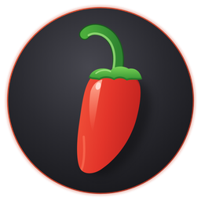
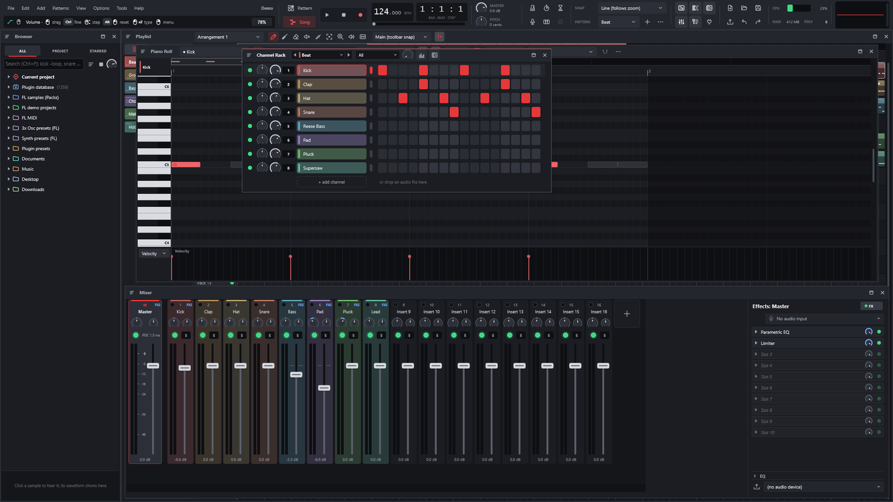
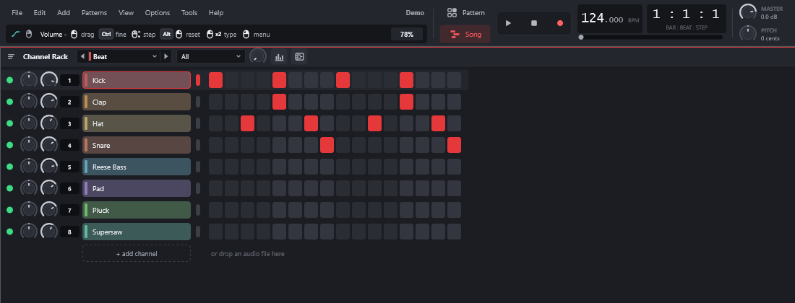
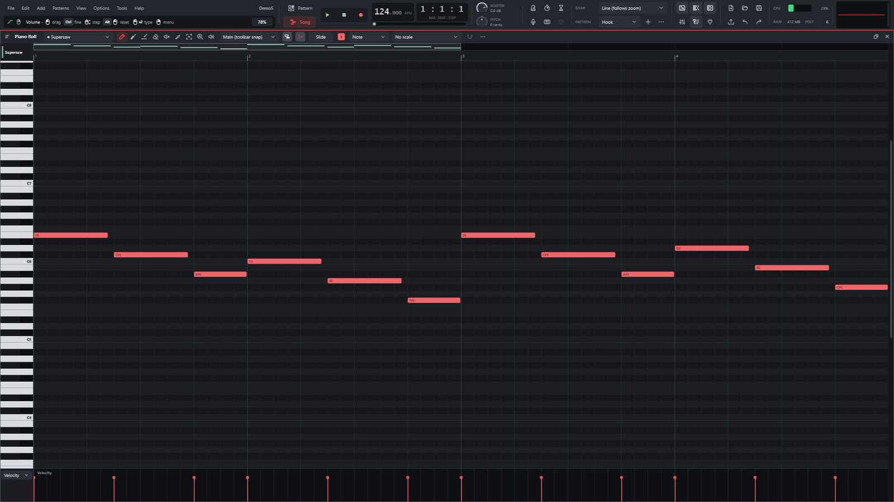
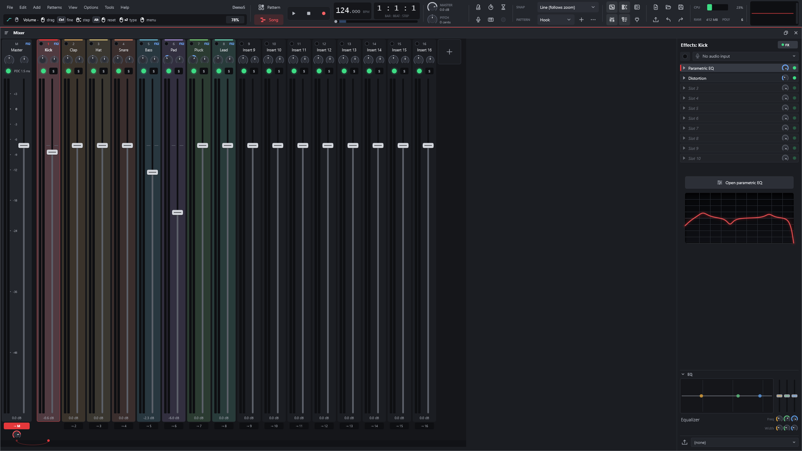

<p align="center">
  
</p>

<h1 align="center">LYNX</h1>

<p align="center"><strong>A lightweight DAW with the FL Studio workflow.</strong><br>
Channel Rack, Piano Roll, Playlist and Mixer in C++20 + JUCE 8, built to run well on any PC.<br>
Windows, macOS and Linux.</p>

<p align="center">
  <a href="https://github.com/Ka1-S/LYNX/releases"></a>
</p>

<p align="center">
  <a href="https://lynx-share.com"><strong>Website</strong></a> ·
  <a href="https://github.com/Ka1-S/LYNX/releases"><strong>Download</strong></a> ·
  <a href="#features"><strong>Features</strong></a> ·
  <a href="#opens-fl-studio-projects">FL projects</a> ·
  <a href="docs/PLUGINS.md">Built-in plugins</a> ·
  <a href="#building">Building</a> ·
  <a href="docs/STATUS.md">Status</a> ·
  <a href="docs/ROADMAP.md">Roadmap</a>
</p>

<p align="center">
  <a href="https://github.com/Ka1-S/LYNX/actions/workflows/tests.yml"></a>
  
  
  
  
  
  
  
  <a href="LICENSE"></a>
</p>

<p align="center">
  
  <br><sub>LYNX's own demo project (<code>LYNX.exe --showcase</code>) in the 0.1.18 workspace: browser, Piano Roll, Channel Rack and Mixer.</sub>
</p>

---

<!-- inspired:begin (generated by scripts/gen-inspired.py) -->
## Inspired by the classics

LYNX ships **native** plugins inspired by the third-party plugins producers use most, next to its clean-room FL Studio natives. 24 dedicated LYNX engines are in, more are being built, and a project that uses one of the 56 originals below **opens with the LYNX equivalent** when the original is not installed (its settings are kept and come back once it is; see [PLUGIN_FALLBACK.md](docs/PLUGIN_FALLBACK.md)).

| Vendor | Inspired by → LYNX plugin |
|---|---|
| **FabFilter** | Pro-L 2 → **Apex Limiter** · Pro-C 2 / 3 → **Crest Compressor** · Pro-MB → **Prism Multiband** · Pro-G → **Sentry Gate** · Pro-Q 2 / 3 / 4 → **Facet EQ** · Pro-DS → **Hush De-esser** · Saturn → **Ember Saturator** · Pro-R 2 → LuxeVerb (stand-in) · Timeless 3 → Fruity Delay 3 (stand-in) |
| **Valhalla DSP** | VintageVerb → **Epoch Verb** · Room → **Atrium** · Plate → **Foil Plate** · Supermassive → **Nebula** · Shimmer → **Halo** · FutureVerb → **Horizon** · Delay → **Echoform** · FreqEcho → **Spiral Echo** · SpaceModulator → **Orbit** · UberMod → **Lattice Mod** |
| **Antares** | Auto-Tune → **LYNX Tune** |
| **Waves** | H-Delay → **Echoform** · CLA-2A → **Glow Leveler** · CLA-76 → **Crest Compressor** · SSL E-Channel → **Ridge Strip** · S1 Imager → **Stereo Shaper** · DeEsser → **Hush De-esser** · NS1 → **Quell Denoiser** · Doubler → **Gemini Doubler** · Tune Real-Time → **LYNX Tune** · RVerb, H-Reverb, TrueVerb → Reeverb 2 (stand-in) · SuperTap → Fruity Delay 3 (stand-in) · L1, L2, L3, L4 → Limiter (stand-in) · Renaissance Compressor → Compressor (stand-in) · CLA-76, CLA-3A, C1, SSLComp, API-2500 → Compressor (stand-in) · Q10, Renaissance EQ, SSL EQ → Parametric EQ (stand-in) |
| **Solid State Logic** | Native Channel Strip, 4K E → **Ridge Strip** |
| **Soundtoys** | Little Plate → **Foil Plate** · EchoBoy → **Echoform** · PrimalTap → **Echoform** · Decapitator → **Ember Saturator** · Little AlterBoy → **LYNX Tune** · PanMan → Auto-pan (stand-in) |
| **Slate Digital** | Fresh Air → **Aether** |
| **Harrison** | De-Esser → **Hush De-esser** |
| **Complete Access (role)** | channel strips (SSL 4K G, Harrison 32C / MPC, Slate VCC / Virtual Mix Rack) → **Ridge Strip** · bus / smart compressors (SSL Bus Compressor 2, G3, VBC, sonible smart:comp, pure:comp) → **Crest Compressor** · optical levelers (Slate FG-2A, SD-3A, Custom Opto) → **Glow Leveler** · limiters (Slate FG-X 2, SSL X-Limit, sonible smart:limit, pure:limit) → **Apex Limiter** · EQs (Slate Infinity EQ, FG-73 / FG-N / FG-S / SD-PE1 / CS-EQ, Eiosis AirEQ, SSL X-EQ 2, sonible smart:EQ) → **Facet EQ** · de-essers (SSL DeEss, Slate FG-DS 902, Eiosis E2Deesser, sonible smart:deess) → **Hush De-esser** · gates (SSL X-Gate, Slate Gate Classic / Drums, Harrison Spectral Gate) → **Sentry Gate** · reverbs (LiquidSonics Lustrous Plates / Seventh Heaven / Cinematic Rooms, Slate VerbSuite Classics, SSL FlexVerb / PlateVerb / SpringVerb, sonible smart:reverb) → **Foil Plate** · delays (SSL X-Echo / X-Delay, Slate Stellar Echo SD-201, Harrison 3D Delay) → **Echoform** · saturators (Slate Heatwave / Revival, SSL Fusion Vintage Drive / X-Saturator, Harrison Tape Saturator) → **Ember Saturator** · pitch correction (Slate MetaTune) → **LYNX Tune** · vintage compressor models (Slate FG-116 / FG-76 / FG-401 / FG-A / FG-Dynamics, SSL X-ValveComp) → Compressor (stand-in) |
| **Image-Line FL Studio** | 69 natives at Exact / Near-exact quality: 3x Osc, FL Keys, Gross Beat, Fruity Limiter, Parametric EQ, Soundgoodizer, Maximus, Fruity Delay 3, Reeverb 2, Fruity Compressor, Epoch Verb, Nebula, Atrium, Foil Plate, Echoform, Crest Compressor, Prism Multiband, Sentry Gate … ([all of them](docs/PLUGINS.md)) |

<sub>Product and company names are trademarks of their respective owners. They are used only to describe compatibility and the role each LYNX engine plays. LYNX is not affiliated with, endorsed or sponsored by any of them and contains none of their code, presets, graphics or audio.</sub>
<!-- inspired:end -->

## Highlights

<table>
<tr>
<td width="25%" valign="top">

### ⚡ Lightweight
Lock-free engine, channels and mixer spread across threads, idle channels skipped and long audio streamed from disk. A 125-track project renders at more than 10× real time. Measured against FL Studio 2026 on the same PC: 2.5–7× less RAM, demo songs open faster and render 2–3× faster ([benchmark](docs/analise/REA_rodada116.md)).

</td>
<td width="25%" valign="top">

### 🍒 FL workflow
Step-sequencer Channel Rack, patterns, Piano Roll, Playlist with arrangements, Mixer with inserts, sends and sidechain. Same shortcuts.

</td>
<td width="25%" valign="top">

### 📂 Opens `.flp`
Imports FL Studio projects: channels, samples, patterns, arrangement, automation, mixer and 60+ native plugins converted, most of them bit-exact.

</td>
<td width="25%" valign="top">

### 🔬 Clean-room
FL Studio's behaviour was studied through behavioural reverse engineering and documented; not a single line of Image-Line code was copied.

</td>
</tr>
</table>

## Features

<p align="center">
  
  <br><sub><strong>Playlist:</strong> pattern, automation and audio clips with a clip menu on right-click (split, chop, merge, reverse, normalize, fit to tempo and more).</sub>
</p>

<table>
<tr>
<td width="50%" valign="top">


### Channel Rack
Step sequencer with per-channel volume, pan, mute and solo, swing, multiple patterns (name, colour, length, clone), cut groups, arpeggiator and the PC keyboard as a piano.

</td>
<td width="50%" valign="top">


### Piano Roll
Configurable snap, chords and scales, 16 note colors, note groups, a chord readout, select tools (invert, odd/even, random, overlapping), quantize, slide and porta notes, velocity/pan/pitch lane, `.mid` import and export.

</td>
</tr>
<tr>
<td width="50%" valign="top">


### Mixer
Up to 127 inserts, sends with levels, 10 effect slots with dry/wet per track, built-in EQ (or a **clean mixer** with none), PDC, smart disable and **sidechain** (here the bass compressor listening to the kick). Choose how many inserts new projects start with and show only the used ones.

</td>
<td width="50%" valign="top">


### Built-in synth
3 oscillators (including a band-limited **harmonics** oscillator), LP/BP/HP/BS filter with keytracking, FM and ring modulation, envelopes, 4 LFOs, kick sweep, mono and portamento.

</td>
</tr>
<tr>
<td width="50%" valign="top">


### 7-band parametric EQ
Draggable handles, shelves, 12–48 dB/oct cuts, band-pass and notch, with the response drawn in real time.

</td>
<td width="50%" valign="top">


### Automation
Any knob or fader (channel, mixer, effect, plugin parameter) becomes a clip with points and curves; MIDI controllers can be linked to any parameter.

</td>
</tr>
</table>

### Everything in the box

<table>
<tr>
<td width="33%" valign="top">

#### Instruments
- 3-oscillator synth with an evolving harmonics oscillator, SVF or 4-pole ladder filter and a vintage chorus
- Sampler with zones, slices, time-stretch (Signalsmith Stretch) and disk streaming
- **LYNX Soundfont**: SF2/SF3 player with a preset search across all your SoundFonts
- Built-in drums (kick, snare, hat, clap)
- VST3 and CLAP plugins on every OS, plus Audio Units on macOS and LV2 on Linux; on Windows and Linux optionally sandboxed in a separate process; a searchable plugin picker with favorites

</td>
<td width="33%" valign="top">

#### Effects
- EQ, 7-band parametric EQ, compressor with sidechain, limiter
- Delay, reverb, chorus, filter, distortion, lo-fi
- Effector (12 algorithms), vocoder with side inputs, pitch correction
- Volume gate, rhythmic envelope, auto-pan, Linkwitz-Riley crossover
- Pitch shift, frequency shifter, utility, Patcher (a node graph of effects, instruments and plugins with audio, MIDI and control cables)

</td>
<td width="33%" valign="top">

#### Projects and files
- Native `.lynx` format (JSON) with autosave
- Imports `.flp` and `.mid`; FL `.fst` presets
- Exports WAV 16/24/32f, FLAC and OGG, song or pattern, with dither
- Note recording (PC keyboard and MIDI) and audio recording, sample-accurate with a round-trip ping, punch in/out with pre/post-roll, loop takes and comping, crash-safe takes
- Themes (accent color, background, workspace image) and plugin presets
- Undo/redo on every edit
- Opt-in crash and freeze reports (anonymous), or a prefilled GitHub bug report
- Audio drivers: Windows Audio (WASAPI), DirectSound and ASIO on Windows; Core Audio on macOS; PipeWire (native), JACK and ALSA on Linux
- Any insert to any hardware output, including single mono channels

</td>
</tr>
</table>

## Built-in plugins

LYNX's native engines are clean-room re-implementations of FL Studio's native plugins, each checked against the
original running unmodified. The full list — every engine, what it is compatible with, its status and what is still
missing — is in [`docs/PLUGINS.md`](docs/PLUGINS.md).

**Featured** — the plugins FL Studio users reach for most, all at *Exact* or *Near-exact* quality in LYNX:

| LYNX engine | Inspired by / compatible with | Status |
|---|---|---|
| 3x Osc engine | 3x Osc (FL Studio) | Exact |
| FL Keys engine | FL Keys (FL Studio) | Exact |
| Gross Beat | Gross Beat (FL Studio) | Exact |
| Fruity Limiter | Fruity Limiter (FL Studio) | Near-exact |
| Parametric EQ | Fruity Parametric EQ 2 (FL Studio) | Near-exact |
| Soundgoodizer | Soundgoodizer (FL Studio) | Near-exact |
| Maximus | Maximus (FL Studio) | Near-exact |
| Fruity Delay 3 | Fruity Delay 3 (FL Studio) | Exact |
| Reeverb 2 | Fruity Reeverb 2 (FL Studio) | Exact |
| Fruity Compressor | Fruity Compressor (FL Studio) | Exact |

What each one does, how you get it (any insert or from an `.flp`) and the whole list are in
[`docs/PLUGINS.md`](docs/PLUGINS.md#featured).

**All built-in plugins:**

| | Exact | Near-exact | Close | Approximate | Placeholder |
|---|---:|---:|---:|---:|---:|
| **Generators** (3x Osc, DX10, Sytrus, Harmor, FL Keys, DirectWave, …) | 12 | 10 | 7 | 1 | 2 |
| **Effects** (Parametric EQ 2, Limiter, Reeverb 2, Delay 3, Gross Beat, Love Philter, …) | 34 | 10 | 1 | 8 | 1 |

*Exact* = bit-identical to the original on every installation state tested; *near-exact* = the rest below about
−100 dB; *close* = same algorithm, within −60 dB. Plugin names are Image-Line's trademarks, used only to describe
compatibility; LYNX is not affiliated with Image-Line.

## Opens FL Studio projects

LYNX reads the `.flp` format directly and converts everything that has an equivalent:

- **Structure:** channels, real samples (including the Ogg Vorbis WAVs and WavPack files shipped with FL), patterns, slide/porta notes, every arrangement, markers, time-signature changes, automation and controller links.
- **Mixer:** routing, levels, sidechains, track EQ and native effects with their saved settings (Parametric EQ 2, Limiter, Compressor, Reeverb 2, Delay 3, Maximus, Gross Beat, Effector, Love Philter, Frequency Splitter, Patcher, Pitcher, Vocoder, Newtone/Newtime and more).
- **Generators on FL's own engines** (checked against FL's DLLs, most of them bit for bit): 3x Osc, SimSynth, MiniSynth, DX10, Kepler, PoiZone, Toxic Biohazard, Transistor Bass, Autogun, Plucked!, BeepMap, Sawer, Granulizer, Drumaxx, FL Slayer, FL Keys, Fruit Kick, Kick, BassDrum, Sakura, Drumpad, BooBass, Fruity DrumSynth Live, GMS, Morphine; Sytrus, Harmless, Harmor (including image synthesis) and Ogun on engines rebuilt from the plugin state. Built-in sounds and tables are read from *your* FL installation, never shipped with LYNX. DirectWave runs on its own exact engine (filters, modulation matrix and effects); FPC, Slicex, Fruity Slicer and Wave Traveller play as samplers through FL's own interpolators.
- **Exact native effects:** Parametric EQ 2, EQUO, Limiter, Compressor, Multiband Compressor, Maximus, Soundgoodizer, Reeverb 2, LuxeVerb, Convolver, Delay 3, Delay Bank, the chorus family, Flangus, Flanger, Fast Dist, WaveShaper, Soft Clipper, Stereo Shaper/Enhancer, Transient Processor, Frequency Splitter, Fast LP, Free Filter, Fruity Filter, Pitch Shifter, Love Philter, Fruity Vocoder, Vocodex, Hardcore, Distructor, Multiband Delay, Gross Beat, Effector, Vintage Phaser, Pitcher and more reproduce FL's algorithms; how each one was decoded is documented in [`docs/analise/`](docs/analise/).
- **Third-party plugins:** VST3/CLAP plugins inside the Fruity Wrapper are swapped for the same installed plugin, preset included.

A report lists what was converted, what is approximated and what was left out. FLEX packs are encrypted and are never opened (the channel gets a synth patch chosen by preset name).

> [!NOTE]
> Every conversion rule comes from **behavioural** reverse engineering (decompilation studied, official manual and project data), recorded in [`docs/analise/`](docs/analise). Anything not confirmed is flagged as an approximation in [`docs/STATUS.md`](docs/STATUS.md).

## Download

Every release on the [latest release page](https://github.com/Ka1-S/LYNX/releases) has builds for all three
platforms (`<v>` is the version, e.g. `0.1.10-alpha`):

| OS | Download | Notes |
|---|---|---|
| **Windows** 10 / 11, 64-bit | `LYNX-<v>-setup-x64.exe` (installer) or `LYNX-<v>-windows-x64.zip` (portable) | per-user installer, no admin rights |
| **macOS** 11 Big Sur or newer | `LYNX-<v>-macos-universal.dmg` | universal: Apple Silicon and Intel |
| **Linux** x86_64, glibc 2.35+ | `LYNX-<v>-x86_64.AppImage` or `LYNX-<v>-linux-x86_64.tar.gz` | Ubuntu 22.04+, Debian 12+, Fedora 36+, current Arch / Manjaro |

Release files are built from the tagged source by GitHub Actions ([`release.yml`](.github/workflows/release.yml)) and
listed with their SHA-256 in `SHA256SUMS.txt`. Releases up to 0.1.7 are Windows-only; up to 0.1.12 the AppImage was named
`LYNX-<v>-linux-x86_64.AppImage` and needed glibc 2.39.

**Windows.** Run the installer: it needs no admin rights, adds Start-menu/desktop shortcuts, opens `.lynx` projects and
offers LYNX in *Open with* for `.flp` without changing FL Studio's default. Prefer no installer? Extract the portable
`.zip` and run `LYNX.exe`. Both include a demo project (`Demo.lynx`). The executable is not code-signed yet, so
SmartScreen may warn on first launch (*More info* → *Run anyway*); see [Code signing policy](#code-signing-policy).

**macOS.** Open the `.dmg` and drag LYNX to *Applications*. The app is not notarized by Apple and has no Developer ID
signature (ad-hoc only), so the first launch needs one extra step: right-click (Control-click) LYNX in *Applications*
→ *Open* → *Open*. On macOS 15 Sequoia or newer, try to open it once, then go to *System Settings* → *Privacy &
Security* and click *Open Anyway*. Or, in Terminal:

```
xattr -dr com.apple.quarantine /Applications/LYNX.app
```

macOS asks for microphone access the first time you record.

**Linux.** Needs X11 or XWayland; audio goes through PipeWire directly (or JACK, or ALSA), see [docs/LINUX.md](docs/LINUX.md). For the
AppImage:

```
chmod +x LYNX-*.AppImage
./LYNX-*.AppImage
```

Some distributions need libfuse2 to run AppImages (`libfuse2` on Ubuntu 22.04, `libfuse2t64` on 24.04, `fuse2` on Arch, `fuse-libs` on Fedora); otherwise
use the `.tar.gz`: extract it and run `./install.sh`, which installs LYNX for your user under `~/.local` with a menu
entry, an icon and the `.lynx` file type (`./install.sh --uninstall` removes it again).

### Platform notes

| | Windows | macOS | Linux |
|---|---|---|---|
| Plugin formats | VST3, CLAP, VST2 | VST3, CLAP, Audio Units | VST3, CLAP, LV2, VST2 |
| Audio drivers | Windows Audio (WASAPI), DirectSound, ASIO, built-in LYNX ASIO driver | Core Audio | PipeWire (native), JACK, ALSA |
| Out-of-process plugin sandbox | optional | – | optional |
| FL Studio integration (factory samples, plugin database) | FL Studio installation | FL Studio app bundle is looked for (untested) | Windows FL Studio under Wine (`~/.wine` or `$WINEPREFIX`) |
| Settings folder | `%APPDATA%\LYNX` | `~/Library/Application Support/LYNX` | `~/.config/LYNX` (`$XDG_CONFIG_HOME`) |

Opening FL Studio projects (`.flp`) works on every OS; the FL Studio integration only adds FL's own samples and plugin
paths when an installation is found.

On first start a short setup wizard (skippable; *Options > Setup wizard* reopens it) picks the language, tests the audio
device and lists the plugin folders — the standard VST3/CLAP folders plus the ones FL Studio uses on the same PC — and
scans them in the background. If FL Studio is installed, `.flp` projects use the very plugin files FL uses (read from its
plugin database) and find samples in FL's folders; a plugin LYNX doesn't know yet gets a quick scan of just its file
([details](docs/FL_INTEGRATION.md)).

## Command line

`LYNX.exe` also runs headless, which is how everything is verified without opening windows. On macOS and Linux the
binary is `LYNX` (`/Applications/LYNX.app/Contents/MacOS/LYNX` on macOS); the options are the same:

```
LYNX.exe project.lynx                          open a project (.lynx, .flp or .mid)
LYNX.exe --export project.flp out.flac         render the song (wav/flac/ogg)
LYNX.exe --render project.flp out.wav 20       render 20 s of the current pattern (24-bit WAV)
LYNX.exe --selftest report.txt [demo.lynx]     self-test without an audio device
LYNX.exe --snapshot prefix project.flp         draw the UI (and its windows) to PNG
LYNX.exe --showcase out.lynx [pattern]         generate the demo project used in these screenshots
LYNX.exe --plugintest plugin.vst3 rep.txt      test a VST3 or CLAP plugin
LYNX.exe --sandboxtest plugin.vst3 rep.txt     test a plugin in a separate process (including a hung one)
LYNX.exe --scantest folder rep.txt             scan a folder for plugins (separate processes)
LYNX.exe --fldb rep.txt [project.flp] [--scan] FL Studio found here, its plugin database, a project's plugin matches
LYNX.exe --devices rep.txt                     list audio drivers and outputs
LYNX.exe --devicetest "ASIO" "driver" rep.txt  open a driver for 1 s of silence and report it
LYNX --uiperf project.flp rep.txt             time the UI drawing: Mixer, Playlist, Channel Rack, playing and scrolling
LYNX.AppImage --menu-entry on|off             Linux AppImage: add to / remove from the applications menu
```

## Shortcuts

| Key | Action |
|---|---|
| Space | Play / Pause |
| F5 / F6 / F7 / F8 / F9 | Playlist / Channel Rack / Piano Roll / Browser / Mixer |
| L | Toggle Pattern / Song |
| Ctrl+Z / Ctrl+Y | Undo / redo |
| Ctrl+N / Ctrl+O / Ctrl+S | New / Open / Save (Ctrl+Shift+S: save as) |
| Ctrl+R | Export audio |
| `Z`..`M`, `Q`..`P` | Play the selected channel |
| Piano Roll / Playlist | Ctrl+A/C/X/V, Ctrl+B duplicate, Delete; in the Piano Roll also Ctrl+Q and the arrow keys |

## Building

### Windows from WSL/Linux, without Visual Studio (Zig)

```
./scripts/build-windows-zig.sh      # produces build-win/LYNX.exe
```

Needs Zig 0.14.1 in `~/opt/zig-x86_64-linux-0.14.1` and JUCE 8.0.4 in `~/opt/juce-8.0.4`
(or set `ZIG` and `JUCE_DIR`). JUCE 8 does not officially support MinGW; the script works around the
differences (see `cmake/mingw/` and `src/platform/MingwFixes.cpp`).

### Windows with Visual Studio

Requires Visual Studio 2022 Build Tools ("Desktop development with C++"), CMake ≥ 3.22 and Git.

```
cmake -B build -G "Visual Studio 17 2022" -A x64
cmake --build build --config Release
```

### Linux

Ubuntu 24.04 dependencies:

```
sudo apt install build-essential cmake ninja-build pkg-config libasound2-dev libjack-jackd2-dev libx11-dev \
  libxrandr-dev libxinerama-dev libxcursor-dev libxext-dev libxcomposite-dev libfreetype-dev libfontconfig1-dev libgl-dev
```

```
cmake -S . -B build -G Ninja -DCMAKE_BUILD_TYPE=Release
cmake --build build
```

### macOS

Needs the Xcode command line tools (`xcode-select --install`), CMake and Ninja (e.g. `brew install cmake ninja`).

```
cmake -S . -B build -G Ninja -DCMAKE_BUILD_TYPE=Release -DCMAKE_OSX_ARCHITECTURES="arm64;x86_64"
cmake --build build
```

`CMAKE_OSX_ARCHITECTURES="arm64;x86_64"` produces a universal app; leave it out to build for the current Mac only.

### Core tests (any C++20 compiler, no JUCE)

```
./scripts/build-local.sh ["folder with .flp files"]
```

More than a million checks, including parsing the 165 `.flp` projects that ship with FL Studio 2026 when that folder is given. It also builds `build-local/flpdump` (dumps a `.flp`) and `build-local/renderwav`.

## Under the hood

```
src/core/     model, sequencer, instruments, effects and .flp import (plain C++, testable without JUCE)
src/flp/      .flp format reader
src/engine/   audio engine (JUCE): device, graph, samples, plugins, project files
src/ui/       UI: Channel Rack, Piano Roll, Playlist, Mixer, windows
third_party/  CLAP (MIT) and the WavPack decoder (BSD)
tests/        core tests
tools/        flpdump, renderwav, comparewav, make_logo
docs/         architecture, status, roadmap and the behavioural analysis of FL Studio
```

- **Lock-free audio:** the UI edits a copy of the song and publishes an immutable snapshot to the audio thread.
- **Chunked rendering:** every note lands on its exact sample; mixer tracks are processed in parallel layers.
- **Isolated plugins:** plugin scanning always runs in separate processes; optionally the plugins themselves do too (a plugin that hangs goes silent and LYNX keeps playing).

> [!IMPORTANT]
> LYNX is in **alpha**. It already opens, plays and exports whole projects, but it is not yet a replacement for a daily-driver DAW. What works and what is missing is in [`docs/STATUS.md`](docs/STATUS.md); the plan in [`docs/ROADMAP.md`](docs/ROADMAP.md); and a manual test script in [`docs/MANUAL_TESTING.md`](docs/MANUAL_TESTING.md).

## Documentation

| Document | Contents |
|---|---|
| [`docs/STATUS.md`](docs/STATUS.md) | what works, what is approximated and what is missing |
| [`docs/PLUGINS.md`](docs/PLUGINS.md) | the built-in plugins, what each one is compatible with, and its status |
| [`docs/ROADMAP.md`](docs/ROADMAP.md) | project phases |
| [`docs/ARCHITECTURE.md`](docs/ARCHITECTURE.md) | how the engine and the UI are organised |
| [`docs/CODE_SIGNING.md`](docs/CODE_SIGNING.md) | how releases are built and code-signed (SignPath) |
| [`PRIVACY.md`](PRIVACY.md) | privacy policy: no network connections of its own except an opt-in, anonymised crash report |
| [`docs/MANUAL_TESTING.md`](docs/MANUAL_TESTING.md) | a script for listening to and poking at what the automated tests don't cover |
| [`docs/analise/`](docs/analise) | FL Studio's behaviour, documented round by round (clean-room) |

> [!NOTE]
> The documentation is being translated from Portuguese to English; some files are still in Portuguese.

## Credits and notice

LYNX is an independent implementation. FL Studio was studied only to understand its behaviour and file format; no Image-Line code was copied, and no protected content (such as FLEX packs) is ever opened.

FL Studio is a registered trademark of Image-Line Software. LYNX is not affiliated with Image-Line. VST is a registered trademark of Steinberg Media Technologies GmbH.

Built with [JUCE](https://juce.com), [CLAP](https://github.com/free-audio/clap), the [WavPack](https://www.wavpack.com) decoder and the Steinberg ASIO SDK — their licences are listed in [`THIRD_PARTY.md`](THIRD_PARTY.md).

## Code signing policy

Free code signing provided by [SignPath.io](https://about.signpath.io), certificate by
[SignPath Foundation](https://signpath.org). *(Pending approval: until the application is accepted, release
binaries are not signed.)* This covers the Windows binaries. The macOS app has an ad-hoc signature only (no Apple
Developer ID, not notarized); Linux packages are not signed.

- Release binaries are built only from this repository by GitHub Actions
  ([`.github/workflows/release.yml`](.github/workflows/release.yml)); nothing built on a personal machine is signed.
- Every signing request is approved manually for each release.
- Team roles:
  - Committers and reviewers ("Authors" and "Reviewers"): [Ka1-S](https://github.com/Ka1-S)
  - Approvers: [Ka1-S](https://github.com/Ka1-S)

**Privacy:** This program will not transfer any information to other networked systems unless specifically
requested by the user or the person installing or operating it. See [`PRIVACY.md`](PRIVACY.md).

**Crash reports (opt-in):** after a crash or freeze LYNX asks before sending a report to lynx-share.com (*Send* /
*Show what will be sent* / *Don't send*, or *Report on GitHub instead*); Settings › General › Crash reports sets *Ask*
(default), *Always send* or *Never send*, and Help › Report a problem… sends one by hand. A report has the LYNX
version, OS, CPU, graphics card and driver, audio device, the crash or freeze file, the last steps and the loaded
third-party plugins — no audio, projects, file names, user or machine name, and the server stores no IP address.
Details and how to have a report deleted: [`PRIVACY.md`](PRIVACY.md#crash-reports-opt-in).

## License

LYNX is free software under the [GNU Affero General Public License v3.0](LICENSE): you may use, study, modify and
redistribute it; anyone who distributes a modified version (including as a network service) must publish its source
code under the same license.

<p align="center">
  <a href="https://star-history.com/#Ka1-S/LYNX&Date">
    
  </a>
</p>
